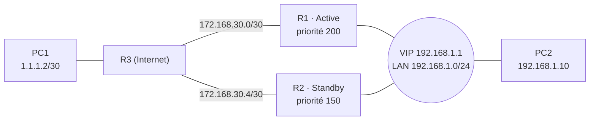

# Haute disponibilité et redondance : HSRP, STP et LACP

> [!abstract] En bref
> Un réseau sans point unique de défaillance : deux routeurs en HSRP derrière une passerelle virtuelle, un maillage de switches protégé des boucles par STP, et des liens agrégés en LACP. Chaque mécanisme est validé par une panne provoquée. Le test a aussi montré que HSRP seul ne suffit pas : le routage statique empêchait le trafic de retour de suivre la bascule, et OSPF a corrigé le problème.

| | |
| :--- | :--- |
| **Contexte** | Bachelor Cybersécurité et Administrateur Réseaux, module Réseau avancé |
| **Outil** | Cisco Packet Tracer |
| **Équipements** | 2 routeurs ISR4331 (R1, R2), 1 routeur 2911 (R3, « Internet »), 4 switches 2960, 2 PC |
| **Date** | Novembre 2026 |

## Objectifs

- Assurer la continuité de la passerelle du LAN avec HSRP.
- Supprimer les boucles d'un réseau de switches maillé avec STP, et comprendre ses choix.
- Doubler les liens entre switches et les agréger avec LACP.
- Prouver chaque mécanisme par une panne réelle.

## Topologie et adressage



| Équipement | Interface | Adresse | Rôle |
| :--- | :--- | :--- | :--- |
| R1 | Gig0/0/0 | 192.168.1.2/24 | LAN, HSRP Active |
| R1 | Gig0/0/1 | 172.168.30.2/30 | Lien vers R3 |
| R2 | Gig0/0/0 | 192.168.1.3/24 | LAN, HSRP Standby |
| R2 | Gig0/0/1 | 172.168.30.6/30 | Lien vers R3 |
| R3 | Gig0/0 / Gig0/1 | 172.168.30.1 / .5 /30 | Liens vers R1 et R2 |
| R3 | Gig0/2 | 1.1.1.1/30 | Réseau de PC1 |
| HSRP | IP virtuelle | 192.168.1.1 | Passerelle du LAN, groupe 1 |

## 1. Remise en état de la connectivité

Au départ, PC1 ne joignait pas le LAN. Trois causes ont été identifiées et corrigées :

| Problème | Diagnostic | Correction |
| :--- | :--- | :--- |
| Câblage de R3 inversé | Liens physiquement actifs mais pings à 0/5 : chaque extrémité était dans un /30 différent | Inversion des deux câbles côté R3 |
| Routes manquantes | R3 ne connaissait pas 192.168.1.0/24, R1 et R2 n'avaient pas de route par défaut | Routes statiques, dont une route flottante (distance 10) vers R2 |
| Priorité HSRP identique | R1 n'était Active que par départage sur l'IP la plus haute | Priorité de R2 ramenée à 150 |

## 2. HSRP : une passerelle qui survit à la panne d'un routeur

```text
R1(config)# interface GigabitEthernet0/0/0
R1(config-if)# standby 1 ip 192.168.1.1
R1(config-if)# standby 1 priority 200
R1(config-if)# standby 1 preempt

R2(config)# interface GigabitEthernet0/0/0
R2(config-if)# standby 1 ip 192.168.1.1
R2(config-if)# standby 1 priority 150
R2(config-if)# standby 1 preempt
```

**Comment vérifier que les clients utilisent bien la passerelle virtuelle ?** La table ARP de PC2 associe 192.168.1.1 à la MAC `0000.0c07.ac01`. Le préfixe `0000.0c07.ac` est réservé à HSRP v1 et `01` est le numéro de groupe en hexadécimal. Cette adresse diffère de la MAC réelle de R1 : PC2 parle à la passerelle virtuelle, pas à un routeur précis.

**Par où passe réellement le trafic ?** Un `tracert` n'affiche jamais l'IP virtuelle, mais l'IP réelle du routeur actif : ici 192.168.1.2 (R1), puis R3, puis PC1.

**Comment R2 sait-il qu'il doit prendre le relais ?** R1 envoie des *hello* HSRP en multicast (224.0.0.2, UDP 1985) toutes les 3 secondes. Ils portent la priorité, l'état et l'IP virtuelle. Si R2 n'en reçoit plus pendant le *hold time* (10 secondes par défaut), il passe Active. `preempt` permet à R1 de reprendre son rôle à son retour.

| État HSRP | Signification |
| :--- | :--- |
| Initial | HSRP vient d'être configuré ou l'interface vient de monter |
| Learn | L'IP virtuelle n'est pas encore connue, le routeur attend un hello |
| Listen | IP virtuelle connue, le routeur n'est ni Active ni Standby |
| Speak | Le routeur participe à l'élection et envoie des hello |
| Standby | Prochain candidat si l'Active tombe |
| Active | Traite le trafic envoyé à l'IP et à la MAC virtuelles |

### Panne de R1

L'interface LAN de R1 est coupée (`shutdown`) pendant un ping continu de PC2 vers PC1. R2 passe Active (`show standby brief` : *Active local*), le premier saut du `tracert` devient 192.168.1.3 et PC2 n'a rien à reconfigurer.

> [!danger] Limite découverte : le trafic retour ne suivait pas
> Avec le routage statique, le ping restait en échec malgré la bascule. L'aller passait bien par R2, mais R3 continuait d'envoyer les réponses vers R1 : le lien R3–R1 étant toujours actif, la route principale restait dans la table, et la route flottante vers R2 ne s'activait jamais. **HSRP bascule la passerelle des clients, mais le routage doit suivre.**

## 3. OSPF pour que le routage suive la bascule

Les routes statiques sont supprimées (leur distance administrative de 1 l'emporte sur les 110 d'OSPF), puis OSPF est activé en zone 0 sur les trois routeurs. Quand R1 perd son interface LAN, il cesse d'annoncer 192.168.1.0/24, et R3 envoie le trafic de retour vers R2.

```text
R1(config)# no ip route 0.0.0.0 0.0.0.0 172.168.30.1
R1(config)# router ospf 1
R1(config-router)# network 172.168.30.0 0.0.0.3 area 0
R1(config-router)# network 192.168.1.0 0.0.0.255 area 0
R1(config-router)# passive-interface gigabitEthernet 0/0/0
```

R2 et R3 reçoivent la même configuration pour leurs réseaux. Les `passive-interface` évitent d'envoyer des hello OSPF sur le LAN et vers PC1, où il n'y a aucun voisin OSPF, tout en continuant d'annoncer ces réseaux.

**Résultat** : pendant la panne de R1, le ping continu ne perd que **2 paquets**, le temps de la convergence, puis le trafic reprend via R2. Au retour de R1, `preempt` lui rend le rôle Active.

## 4. STP : pas de boucle dans le maillage de switches

Les quatre switches ont la même priorité (32769 = 32768 + VLAN 1). C'est donc l'adresse MAC la plus basse qui désigne la racine : **SW1** (`000C.8564.71CE`).

| Switch | Port | Rôle | État | Relié à |
| :--- | :--- | :--- | :---: | :--- |
| SW1 (racine) | Fa0/1, Fa0/2 | Designated | FWD | SW0, SW3 |
| SW3 | Fa0/2 | Root | FWD | SW1 |
| SW3 | Fa0/1, Fa0/3, Fa0/4 | Designated | FWD | SW2, R1, R2 |
| SW0 | Fa0/2 | Root | FWD | SW1 |
| SW0 | Fa0/1, Fa0/3 | Designated | FWD | PC2, SW2 |
| SW2 | Fa0/1 | Root | FWD | SW0 |
| SW2 | Fa0/2 | **Alternate** | **BLK** | SW3 |

**Pourquoi SW2 bloque-t-il Fa0/2 ?** Ses deux chemins vers la racine coûtent 38 (19 + 19), l'un par SW0, l'autre par SW3. À coût égal, STP départage sur le plus petit BID du voisin : SW0 (`000C.8580.32AC`) passe devant SW3 (`0050.0F2E.EA52`). Le lien vers SW3 est bloqué, ce qui casse la seule boucle du réseau.

## 5. LACP : des liens doublés qui encaissent une coupure

Les liens SW0–SW1 et SW1–SW3 sont doublés et agrégés en EtherChannel LACP.

| Lien | Côté A | Côté B |
| :--- | :--- | :--- |
| SW0 – SW1 | SW0 : Po1 (Fa0/2, Fa0/4) | SW1 : Po1 (Fa0/1, Fa0/4) |
| SW1 – SW3 | SW1 : Po2 (Fa0/2, Fa0/3) | SW3 : Po1 (Fa0/2, Fa0/5) |

```text
SW1(config)# interface range fastEthernet 0/2 , fastEthernet 0/3
SW1(config-if-range)# channel-protocol lacp
SW1(config-if-range)# channel-group 2 mode active
```

`show etherchannel summary` affiche chaque bundle en `SU` (couche 2, en service) avec ses ports en `(P)`. L'agrégation modifie aussi STP, qui ne voit plus qu'un lien logique : le port racine de SW0 devient Po1, avec un coût de 12 au lieu de 19.

**Test de panne** : un câble SW1–SW3 est retiré pendant un ping continu. Le port passe de `(P)` à `(D)`, Po2 reste `SU` avec un seul membre, et **aucun paquet n'est perdu**. Au rebranchement, le port repasse en `(P)`.

## Bilan

| Mécanisme | Test de panne | Résultat |
| :--- | :--- | :--- |
| HSRP + OSPF | Coupure du LAN de R1 | Bascule sur R2, 2 paquets perdus, retour automatique de R1 |
| STP | Maillage avec boucle | Un seul port bloqué (SW2 Fa0/2), aucune boucle |
| LACP | Retrait d'un câble d'un bundle | Aucune perte, le lien logique continue à mi-débit |

## Ce que j'en retiens

- La redondance de la passerelle (HSRP) et celle du routage sont deux problèmes distincts : sans protocole dynamique, la bascule n'est qu'à moitié faite.
- Un test de panne réel révèle ce qu'une configuration « qui semble correcte » ne montre pas.
- **Piste d'amélioration** : HSRP ne surveille que l'interface LAN. Si le lien R1–R3 tombait alors que le LAN de R1 reste actif, R1 resterait Active sans pouvoir sortir. `standby track` sur l'interface amont répond à ce cas.
