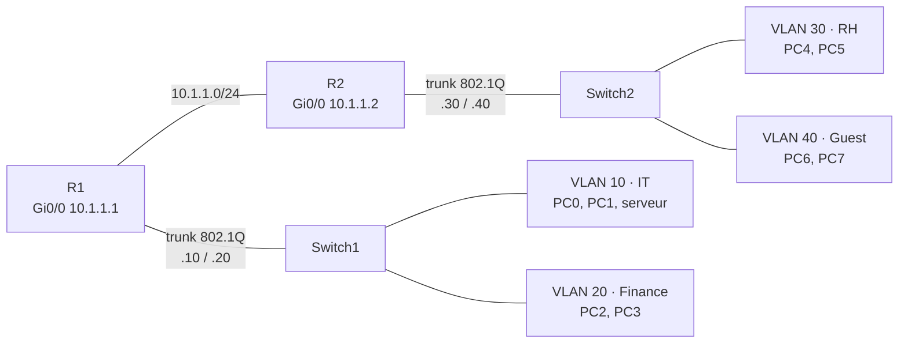

# VLAN, routage inter-VLAN et ACL

> [!abstract] En bref
> Réseau d'entreprise simulé en quatre VLAN (IT, Finance, RH, Guest) répartis sur deux sites reliés par deux routeurs. Routage inter-VLAN en *router-on-a-stick*, routage statique entre les routeurs, puis cloisonnement des flux par ACL standard et étendues. Chaque règle est prouvée par un test qui passe et un test qui échoue.

| | |
| :--- | :--- |
| **Contexte** | Bachelor Cybersécurité et Administrateur Réseaux, module Réseau avancé |
| **Outil** | Cisco Packet Tracer |
| **Équipements** | 2 routeurs Cisco 1941, 2 switches 2960-24TT, 8 PC, 1 serveur |
| **Date** | Octobre 2026 |

## Objectifs

- Segmenter le réseau en VLAN par métier, affectés par port.
- Faire communiquer les VLAN entre eux via les routeurs (sous-interfaces 802.1Q).
- Relier les deux sites par du routage statique.
- Rétablir un cloisonnement fin entre VLAN avec des ACL, puisque le routage inter-VLAN supprime l'isolation de niveau 2.

## Topologie et adressage



| VLAN | Nom | Réseau | Passerelle | Porté par |
| :---: | :--- | :--- | :--- | :--- |
| 10 | IT | 192.168.10.0/24 | 192.168.10.1 | R1 – Gi0/1.10 |
| 20 | Finance | 192.168.20.0/24 | 192.168.20.1 | R1 – Gi0/1.20 |
| 30 | RH | 192.168.30.0/24 | 192.168.30.1 | R2 – Gi0/1.30 |
| 40 | Guest | 192.168.40.0/24 | 192.168.40.1 | R2 – Gi0/1.40 |
| – | Lien R1–R2 | 10.1.1.0/24 | – | R1 Gi0/0 = .1, R2 Gi0/0 = .2 |

Le serveur du VLAN IT (192.168.10.4) héberge trois services utilisés pour prouver le filtrage : HTTP, DNS et FTP.

## 1. VLAN et affectation par port

Les VLAN sont créés sur chaque switch, les ports des PC passent en mode *access*, et le port vers le routeur passe en *trunk* limité aux seuls VLAN utiles.

```text
Switch1(config)# vlan 10
Switch1(config-vlan)# name IT
Switch1(config)# vlan 20
Switch1(config-vlan)# name Finance
Switch1(config)# interface range fastEthernet 0/1 - 2
Switch1(config-if-range)# switchport mode access
Switch1(config-if-range)# switchport access vlan 10
Switch1(config)# interface range fastEthernet 0/3 - 4
Switch1(config-if-range)# switchport mode access
Switch1(config-if-range)# switchport access vlan 20
Switch1(config)# interface fastEthernet 0/5
Switch1(config-if)# switchport mode access
Switch1(config-if)# switchport access vlan 10
Switch1(config)# interface fastEthernet 0/24
Switch1(config-if)# switchport mode trunk
Switch1(config-if)# switchport trunk allowed vlan 10,20
```

Switch2 reçoit la même configuration pour les VLAN 30 et 40.

> [!question] Pourquoi l'affectation par port ?
> La topologie est fixe et connue, la méthode se configure et se diagnostique simplement (`show vlan brief` donne directement port → VLAN), et elle ne dépend pas d'une adresse MAC ou IP, toutes deux faciles à usurper. L'affectation par MAC demanderait un serveur VMPS. Le revers : déplacer une machine impose de reconfigurer son port.

**Vérification** : à ce stade, les PC d'un même VLAN se joignent et ceux de VLAN différents non. C'est le comportement attendu, puisqu'aucun routeur n'est encore configuré.

## 2. Routage inter-VLAN (router-on-a-stick)

Un seul lien physique relie chaque routeur à son switch et transporte tous les VLAN. Le routeur le découpe en sous-interfaces, une par VLAN : `encapsulation dot1Q` indique le tag traité, et l'adresse de la sous-interface sert de passerelle aux PC du VLAN. L'interface physique ne porte pas d'adresse, mais doit être activée.

```text
R1(config)# interface GigabitEthernet0/1
R1(config-if)# no shutdown
R1(config)# interface GigabitEthernet0/1.10
R1(config-subif)# encapsulation dot1Q 10
R1(config-subif)# ip address 192.168.10.1 255.255.255.0
R1(config)# interface GigabitEthernet0/1.20
R1(config-subif)# encapsulation dot1Q 20
R1(config-subif)# ip address 192.168.20.1 255.255.255.0
```

**Vérification** : un ping vers sa passerelle répond avec un TTL de 255, la valeur initiale d'un routeur Cisco, preuve qu'aucun saut n'est traversé.

## 3. Routage statique entre les deux sites

Chaque routeur ne connaît que ses réseaux connectés. Il faut une route par réseau distant, avec pour *next hop* l'adresse du voisin sur le lien 10.1.1.0/24.

```text
R1(config)# ip route 192.168.30.0 255.255.255.0 10.1.1.2
R1(config)# ip route 192.168.40.0 255.255.255.0 10.1.1.2
R2(config)# ip route 192.168.10.0 255.255.255.0 10.1.1.1
R2(config)# ip route 192.168.20.0 255.255.255.0 10.1.1.1
```

**Vérification** : `show ip route` affiche deux routes `S` de chaque côté. Les pings entre sites répondent avec un TTL de 126 (128 moins deux routeurs), ceux entre VLAN d'un même routeur avec un TTL de 127.

> [!warning] Conséquence de sécurité
> Une fois le routage en place, l'isolation apportée par les VLAN disparaît : n'importe quel PC joint n'importe quel autre VLAN. Le VLAN ne sépare plus que les domaines de diffusion. Il faut filtrer au niveau 3 et 4, sur les routeurs : c'est le rôle des ACL.

## 4. Cloisonnement par ACL

### Politique de filtrage

| Règle | Routeur / interface | Sens | ACL |
| :--- | :--- | :---: | :--- |
| Guest isolé, sauf DNS vers le serveur IT | R2 – Gi0/1.40 | in | 102 (étendue) |
| IT n'accepte que HTTP, DNS et ICMP | R1 – Gi0/1.10 | out | `IT_OUT` |
| Finance n'émet que DNS et ICMP, sans ICMP vers RH | R1 – Gi0/1.20 | in | `FINANCE_IN` |
| Pas d'ICMP de RH vers Finance | R2 – Gi0/1.30 | in | `RH_IN` |

**Choix de placement :**

- L'ACL du VLAN IT est posée **en sortie** de sa sous-interface : tout le trafic routé vers IT, quelle que soit son origine, passe par là. Une seule ACL suffit au lieu d'une par VLAN source.
- Dans `FINANCE_IN`, le `deny icmp` vers RH est placé **avant** le `permit icmp` général : une ACL est lue de haut en bas et s'arrête à la première correspondance.
- Les deux sens Finance ↔ RH sont bloqués chacun du côté de leur source, sur deux routeurs différents.
- Le `permit ip` final de `RH_IN` est indispensable : sans lui, le *deny* implicite couperait tout le reste du trafic RH.

### Du standard à l'étendue sur le VLAN Guest

Une première ACL standard bloquait toute sortie du VLAN Guest. Elle ne filtre que sur la source, donc elle bloquait aussi le DNS, pourtant autorisé. Elle a été remplacée par une ACL étendue. Le DNS utilise le port 53 en TCP et en UDP, d'où deux lignes.

```text
R2(config)# interface GigabitEthernet0/1.40
R2(config-subif)# no ip access-group 50 in
R2(config)# no access-list 50
R2(config)# access-list 102 permit tcp 192.168.40.0 0.0.0.255 host 192.168.10.4 eq 53
R2(config)# access-list 102 permit udp 192.168.40.0 0.0.0.255 host 192.168.10.4 eq 53
R2(config)# interface GigabitEthernet0/1.40
R2(config-subif)# ip access-group 102 in
```

### ACL nommées sur R1 et R2

```text
R1(config)# ip access-list extended IT_OUT
R1(config-ext-nacl)# permit tcp any 192.168.10.0 0.0.0.255 eq 80
R1(config-ext-nacl)# permit tcp any 192.168.10.0 0.0.0.255 eq 53
R1(config-ext-nacl)# permit udp any 192.168.10.0 0.0.0.255 eq 53
R1(config-ext-nacl)# permit icmp any 192.168.10.0 0.0.0.255
R1(config)# interface GigabitEthernet0/1.10
R1(config-subif)# ip access-group IT_OUT out

R1(config)# ip access-list extended FINANCE_IN
R1(config-ext-nacl)# deny icmp 192.168.20.0 0.0.0.255 192.168.30.0 0.0.0.255
R1(config-ext-nacl)# permit icmp 192.168.20.0 0.0.0.255 any
R1(config-ext-nacl)# permit tcp 192.168.20.0 0.0.0.255 any eq 53
R1(config-ext-nacl)# permit udp 192.168.20.0 0.0.0.255 any eq 53
R1(config)# interface GigabitEthernet0/1.20
R1(config-subif)# ip access-group FINANCE_IN in

R2(config)# ip access-list extended RH_IN
R2(config-ext-nacl)# deny icmp 192.168.30.0 0.0.0.255 192.168.20.0 0.0.0.255
R2(config-ext-nacl)# permit ip 192.168.30.0 0.0.0.255 any
R2(config)# interface GigabitEthernet0/1.30
R2(config-subif)# ip access-group RH_IN in
```

## 5. Preuves de fonctionnement

| Test | Attendu | Obtenu |
| :--- | :---: | :---: |
| RH → HTTP du serveur IT | OK | OK |
| RH → FTP du serveur IT (passait avant les ACL) | KO | KO, *timed out* |
| RH → ping du serveur IT | OK | OK, TTL 126 |
| Finance → ping VLAN IT | OK | OK, TTL 127 |
| Finance → ping VLAN RH | KO | KO, *Destination host unreachable* renvoyé par R1 |
| Finance → DNS du serveur IT | OK | OK |
| Finance → HTTP du serveur IT | KO | KO |
| Guest ↔ Guest | OK | OK, TTL 128 (aucun routeur traversé) |
| Guest → autres VLAN | KO | KO, refus de R2 |
| Guest → DNS du serveur IT | OK | OK |

Les compteurs `match(es)` de `show access-lists` confirment que chaque ligne est effectivement utilisée.

## Problèmes rencontrés

| Problème | Cause | Solution |
| :--- | :--- | :--- |
| `Translating "config"...` sur Switch2 | Commande tapée en mode utilisateur, interprétée comme un nom d'hôte | `enable` puis `configure terminal` (réflexe : `no ip domain-lookup`) |
| Sous-interfaces muettes sur R1 | Interface physique Gi0/1 restée *administratively down* | `no shutdown` sur Gi0/1, sans adresse IP |
| Masque /8 sur le lien R1–R2 | Erreur de saisie | `ip address 10.1.1.1 255.255.255.0` |
| ACL 50 créée sur R1 | Mauvais routeur : le VLAN 40 est porté par R2 | Suppression sur R1, recréation sur R2 |
| DNS Guest bloqué malgré l'ACL 102 | Seule la ligne TCP existait | Ajout de la ligne UDP |
| Guest plus du tout filtré | L'ACL 50 était supprimée mais toujours assignée à l'interface : une interface liée à une ACL inexistante laisse tout passer | `no ip access-group 50 in`, puis `ip access-group 102 in`, contrôle avec `show ip interface` |
| Premier ping en échec | Le premier paquet sert à la résolution ARP | Relancer le ping |

## Ce que j'en retiens

- Le routage inter-VLAN casse l'isolation de niveau 2 : segmenter ne suffit pas, il faut filtrer.
- L'emplacement d'une ACL (routeur, interface, sens) compte autant que son contenu.
- `show ip interface <interface>` et les compteurs de `show access-lists` sont les deux réflexes de vérification. `show interfaces` n'affiche pas les ACL.
- **Piste d'amélioration** : en production, un pare-feu dédié prendrait le relais des ACL pour un filtrage avec état.
